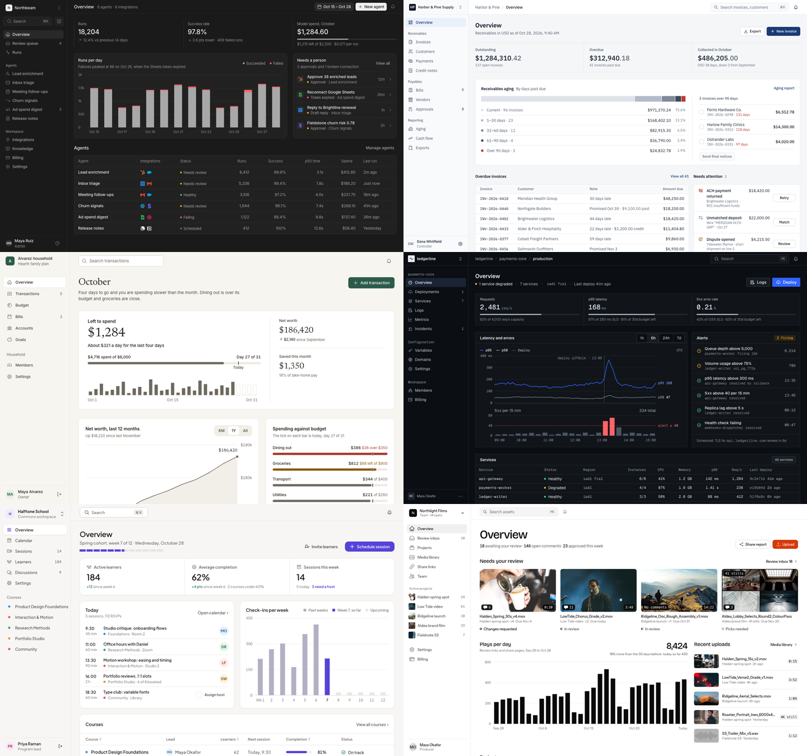

# App design systems

Six complete systems for product screens: dashboards, consoles, lists, settings, admin. Each one restyles the same [seenry-ui](../components/ui/README.md) markup, so a screen moves between systems by swapping two stylesheets ([contract](CONTRACT.md)). They exist so app work starts from a decided, consistent set of values instead of inventing components per screen, and so two projects do not come out looking the same.

| System | Character | Use it for | Type | Icons | Default |
| --- | --- | --- | --- | --- | --- |
| [graphite](graphite/SYSTEM.md) | Lean, three surface greys, a handful of sizes; color only in status and app logos | AI agent consoles, developer tools, ops and marketing software | Inter | Lucide | dark |
| [ledger](ledger/SYSTEM.md) | Dense, hairlines, tabular money, one ink-blue for act and selected | Invoicing, receivables, spend, payroll, back office | IBM Plex Sans and Mono | Tabler | light |
| [paper](paper/SYSTEM.md) | Warm page, white cards, serif titles and big numbers, calm 44px rows | Personal finance, health, habits, journaling, learning | Newsreader with Inter | Phosphor | light |
| [signal](signal/SYSTEM.md) | Sharp, near-black blue-grey, mono for IDs and metrics, one cobalt | Deploys, observability, pipelines, security | Geist and Geist Mono | Remix | dark |
| [bloom](bloom/SYSTEM.md) | Rounded, five category hues in small doses, one violet-blue primary | Scheduling, courses, communities, creator tools | Plus Jakarta Sans | Phosphor duotone | light |
| [studio](studio/SYSTEM.md) | Black and white, big titles, the work as the loudest thing, one red-orange | Creative tools, media libraries, video and design review | Bricolage Grotesque with Instrument Sans | Heroicons | light |

## Choosing one

1. **Fit first.** Match the product's category and the mood of the brief to the *use it for* lines above; each SYSTEM.md also says what it is not for.
2. **The owner's system wins.** An existing app keeps its own tokens and components ([existing project](../../references/existing-project.md)); a system is for new app screens, redesigns and unslop rebuilds.
3. **Differ from recent work.** Run `node scripts/history.mjs --list`: when two systems fit, take the one recent projects did not use, and write `System: <name>` and `Icons: <set>` at the top of `identity.md` so the next project can differ again.
4. **A reference changes the values, not the method.** When the person shows a screen to design like, start from the closest system and move its tokens toward the reference's measured values.

## Using one

Plain CSS: copy `seenry-ui.css`, `seenry-ui.js` and the system's `tokens.css` and `system.css` into the project. Tailwind v4 or shadcn/ui: copy `tokens.css` and `theme.tailwind.css` and import the theme after Tailwind; utilities such as `bg-primary`, `text-muted-foreground` and `rounded-lg` then take the system's values. Then open the system's `gallery.html` and the block for the screen you are building, follow its SYSTEM.md rules, and build with its classes and tokens only. When a component is missing, compose it from the system's tokens and existing classes and say what you built; never invent a value.

## Checking one

`node scripts/system_check.mjs assets/systems/<name>` checks a system against the [contract](CONTRACT.md): files and blocks, every class styled, no typed values, one icon set, and every page rendered at 1440 and 390 in both themes for sideways scroll, errors, contrast, one primary per view, emoji and touch targets. `--critic` adds the blind critic on the dashboard, which must score 8. After changing `tokens.css`, run `node scripts/system_theme.mjs assets/systems/<name>` to regenerate the Tailwind theme.
